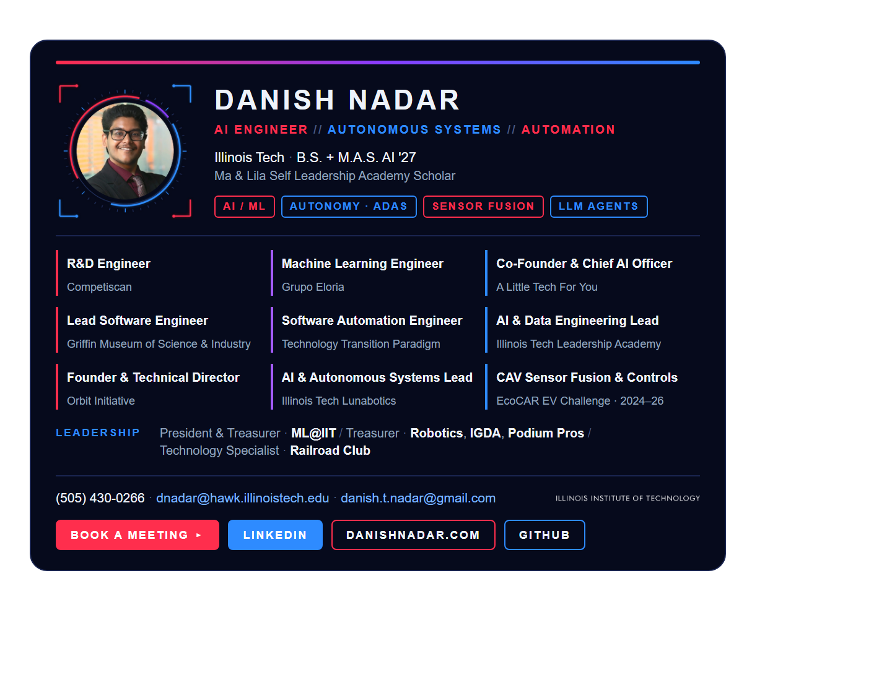
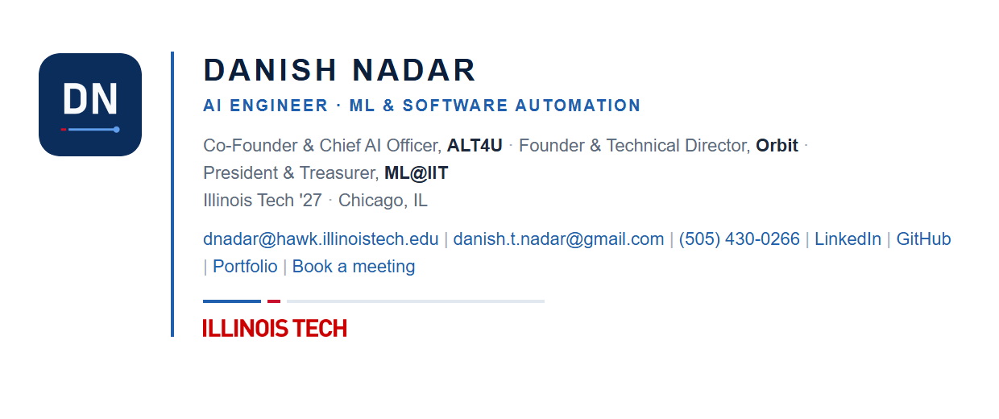

# Email Signatures — Danish Nadar

Production-ready HTML email signatures and a small **Signature Studio** for previewing, customizing, and exporting them.

| | Variant | Use it for |
|---|---|---|
| **D** | Flagship HUD *(primary, for Outlook)* | Everyday signature: dark neon scarlet/blue card, current roles, EcoCAR, booking button |
| **A** | Executive Minimal | Recruiters, administration, first contact |
| **B** | Technical Leadership | Research labs, engineering partners, collaborators |
| **C** | Personal Brand | Startup, founder, and conference outreach |






## Quick start

Requires Node 18+. No `npm install` is needed because there are no dependencies.

```bash
npm run studio        # → http://localhost:5173/studio/
npm run build         # regenerate dist/ from signature.config.js
npm run screenshots   # build + capture screenshots/ with headless Chrome/Edge
npm run assets        # regenerate PNG brand assets (Python + Pillow)
```

The Studio also opens from `studio/index.html` on disk. Use `npm run studio` when you need clipboard and PNG export, which require http.

## ⚠️ Before first use: publish the images

Exported signatures load images from GitHub Pages
(`https://danishnadar.github.io/Email-Signatures/…`, set by `assetBaseUrl` in the config).
New assets in `assets/` must be **committed and pushed** before recipients can see them.
The Studio's export bar checks every hosted image and reports any that are unreachable.

## Repository layout

```
signature.config.js     ← edit this: name, roles, links, logos, colors, per-variant toggles
src/signature.js        renderer shared by the Studio and the build (tables + inline CSS)
studio/                 Signature Studio (vanilla HTML/CSS/JS)
assets/brand/           headshot (ringed + plain circular PNGs), DN monogram
assets/logos/           official organization marks (see assets/logos/README.md)
assets/source/          original vector sources (official Illinois Tech SVGs)
outlook/                Outlook-ready flagship signature + install guide/script
dist/                   built signatures: .html (standalone), .snippet.html, .txt, qa/
screenshots/            QA sheets and final renders
scripts/                build, screenshot, asset, and static-server scripts
images/                 original headshot library (served by the root index.html)
```

## Editing content

Everything is in **`signature.config.js`**:

- **Empty string = hidden.** `phone`, `website`, and `booking` are empty, so they do not render. Placeholder links are never shown.
- **`roles[].variants`** controls which roles appear in each variant. Variant A shows at most two.
- **`logos[]`**: a logo renders only when `src` points to a real file. Only the Illinois Tech wordmark is present now. ML@IIT, ALT4U, Robotics, and Lunabotics are ready for official artwork.
- **`theme`**: Illinois Tech scarlet (`crimson`) plus navy and brand blue. Link text is 6.4:1 on white.
- **Roles:** list active roles only. `group: "student"` roles appear in the flagship's brief *Student leadership* line.

You can also edit in the Studio and use **Download updated config** to save the changes back to a file.

## Outlook (start here)

`npm run build` writes the flagship to **`outlook/Danish Nadar.htm`**. Follow
[`outlook/INSTALL.md`](outlook/INSTALL.md) for new Outlook, Outlook on the web, classic Outlook
(one-click `Install-ClassicOutlook.ps1`), and Outlook for Mac.

## Exporting and installing

In the Studio:

- **Copy signature for Gmail** copies rich HTML that you can paste straight into Gmail, Outlook web, or Outlook for Mac.
- **Copy HTML** copies the raw markup.
- **Download .html** saves a standalone page. Use it for classic Outlook and Apple Mail, where you open it, select all, and copy.
- **Export preview PNG** creates an image for design review only. Never use it as the signature.

The **Install guide** tab has step-by-step instructions for Gmail, Outlook (web/new, classic Windows, Mac), and Apple Mail, plus client limitations.

## Email-client engineering

- Table layout with inline styles only. No flexbox, grid, `<style>`, SVG, background images, or scripts.
- Explicit `width`/`height` on every image, `display:block`, and `-ms-interpolation-mode`. Outlook-safe accent bars are built from table cells.
- The circular headshot is a **transparent PNG**, because Outlook for Windows ignores `border-radius`.
- All essential information is selectable text. Alt text is short enough to fit image boxes when images are blocked.
- Lines wrap **between** items (role, organization, link), never mid-phrase. The layout stays around 400–460 px wide.
- A/B/C are about 5–7k characters, under Gmail's 10,000 limit. The flagship (D) is about 15k, which is fine for
  Outlook. For Gmail, use A, B, or C, or trim D's roles.

### What has and hasn't been verified

| Check | Status |
|---|---|
| Rendering in Chromium (light, simulated dark, 360 px, blocked images) | ✅ `screenshots/qa-variant-*.png` |
| Studio copy / download / PNG export / config reset | ✅ exercised via Chrome DevTools protocol |
| Gmail, Outlook, and Apple Mail rendering | ⏳ **not live-tested**. Send yourself a test email in each client after the assets are pushed. |

Dark-mode previews approximate Gmail/Outlook color inversion. Each client handles dark mode differently, so pixel-identical rendering across clients is not expected.
